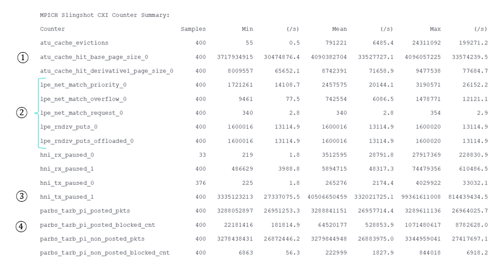
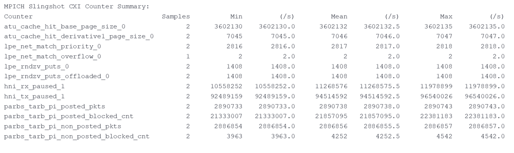

# More diagnostic examples

## Example 1

The following is a distillation of network-facing pause counters from a level 2
counter report for a job that ran for 332 seconds.

In the example here, note the high absolute pause-counter values and
the spread between the minimum, mean, and maximum. The receive pause
indicates that the NIC is telling the network to slow down. The `_0`
suffix identifies the request path, and `_1` identifies the response
path. The transmit pause indicates that the network is telling the NIC
to slow down, with `_0` identifying the request path and `_1` the
response path.

The application ran for 332 seconds. The `TX_1` mean pause count of
44,603,105,200 equates to about 45 seconds with a 1 GHz clock rate (for
the 200Gbps NIC). The rate of 134,346,702 paused cycles per second is
about 13.4% of the NIC's 1 GHz cycles. `hni_tx_paused_1` is an HNI
transmit-pause counter: it indicates that the connected switch is
backpressuring NIC-to-switch transmission on the response sub-class,
not congestion on the PCIe interface. This is large enough to materially
affect wall-clock runtime.

In a rendezvous transfer, the sender transmits the initial control
request on `tx_0`, which the receiver gets on `rx_0`. The receiver then
transmits Get requests on `tx_0`; the sender receives them on `rx_0` and
returns the bulk payload as Get responses on `tx_1`. The receiver gets
that payload on `rx_1`. Thus, bulk-data backpressure appears on the
sender's transmit/response counter and on the receiver's receive/response
counter. A high `TX_1` value means the local NIC is transmitting response
traffic while the switch backpressures it; it does not mean bulk data is
being received by this node or, by itself, establish incast. Similar mean
and maximum values indicate that the transmit pause is widespread across
the measured NICs.

## Example 2

The following is an example of Level 2 counter details:

(1) Note the uniformity of page hits - how many translations of virtual
    addresses for communications hit the cache.

(2) Note a few unexpected messages and rendezvous traffic. While not too
    high - is this understood application behavior? For a GPU application,
    should the rendezvous threshold be lowered to avoid eager messages?

(3) For most of the network facing pause counters, there is some
    variation in the rates of pause between the best and worst NICs, but
    overall, the rates are low, especially compared to the previous
    examples. The exception is the transmit/response channel that has
    very high levels of pause. The mean is 332,021,725 (out of one
    billion given the 1 Ghz clock) meaning paused 33% of the time, and
    the worst NIC is twice as much as that - 814,439,435 or 81% of the
    time.

(4) On the PCIe bus there are some blocked cycles on the write (posted)
    channel, and there is a spread between the worst case and the mean.
    The worst case is 1,071,480,617 blocked cycles out of 3,289,611,136
    packets, or about 0.33 cycles per packet. These are the maximum raw
    counts; the corresponding rates are 8,782,628.0 blocked cycles/s and
    26,964,025.7 packets/s.

## Example 3

Unlike the previous example, in this example you can see very high
per-packet blocking on the PCIe bus.\
The mean ratio of blocked cycles to written packets across PCI is
21857095 / 2890738 = 7.5. This means that there were 7.5 blocked cycles
for every packet. Recall the data transfer for each packet takes 16
cycles, meaning here they are actually taking 23 cycles. This means an
impact of 7.5/23 = 32% hit on bandwidth, although the total blocked time
is only 21857095/1000000000 = 2.2% of the cycles because the packet rate
is low.

Note that the values are fairly uniform across all the NICs, so this
represents something that is uniform that is keeping the CPU or GPU from
accepting the data from the NIC, versus an outlier that might indicate
faulty hardware. Perhaps something in the operating system is not
configured optimally and is creating noise, or bindings and affinities
are not set properly and creating additional on-node latency across
PCIe, or perhaps something in the application is sending data too
rapidly.
