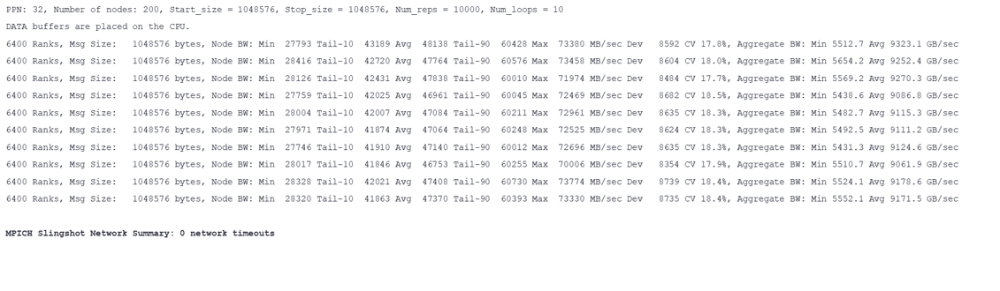

# Level 1 reporting

The following is an example of Level 1 reporting, a single line at the end of
the job output that indicates if any network timeouts occurred. A
network timeout happens when there is no response to an RDMA
transaction, triggering the retry handler. If the job failed and
timeouts are reported, this usually points to a network issue such as
flapping links, downed switches, or an unresponsive destination
endpoint. A completed job with timeouts may signal a transient network
problem affecting performance. Since a single link flap can cause
multiple NICs to experience timeouts, one event may lead to multiple
retries. If no timeouts are detected, this line is omitted unless
additional verbosity is enabled.

The following capture enabled additional verbosity to display the
zero-timeout summary; that line is normally omitted when no timeouts
occur.

